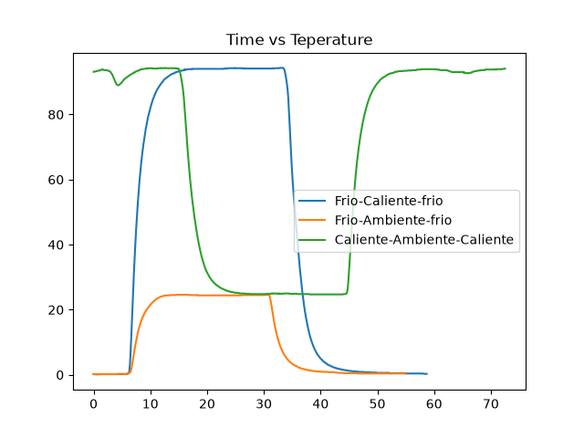
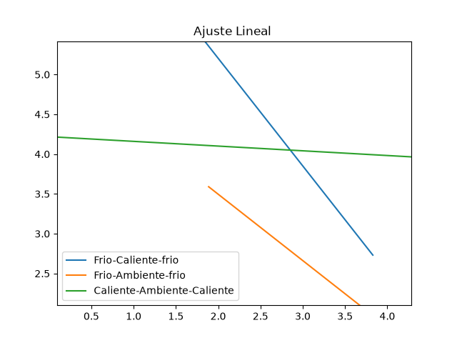

# Análisis termopar 

Como parte de mí formación en Python, y práctica para futuros análisis encaminado a ser asistente de investigación

# Respuesta Dinámica de  un Termopar 

Descripción de los archivos:

Ajuste_lienal_Termopar.png:

**Grafica el ajuste lineal de ln(t)_vs_ln(T)**

RDT.py:

**Script en Python utilizado para procesar los datos del laboratorio y generar las gráficas**

ln(t)_vs_ln(T).png:

**Grafica en escala logarítmica para analizar el comportamiento de la respuesta** 

t_vs_T.png:

**Grafica de Tiempo contra Temperatura** 
# Resultados obtenidos :

_vs_ln(T).png)

# Tiempo de respuesta "tao" para el Termopar utilizado 

tau para el cambio Frio-Caliente-frio es 0.7396313960366379 segundos 
tau para el cambio Frio-Ambiente-frio es  1.1996408238226106 segundos
tau para el cambio Caliente-Ambiente-Caliente es  16.86719291960385 segundos

